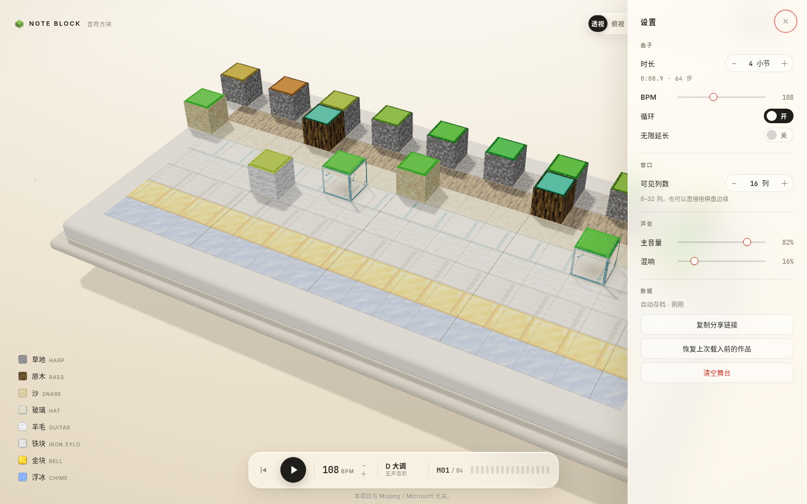
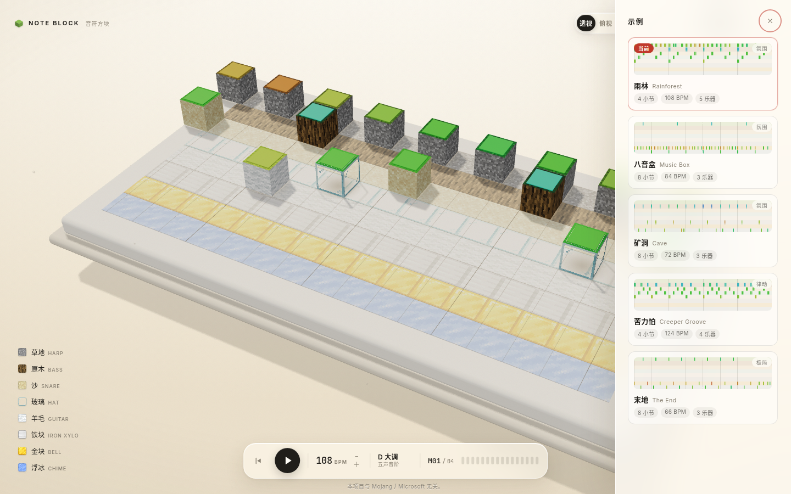
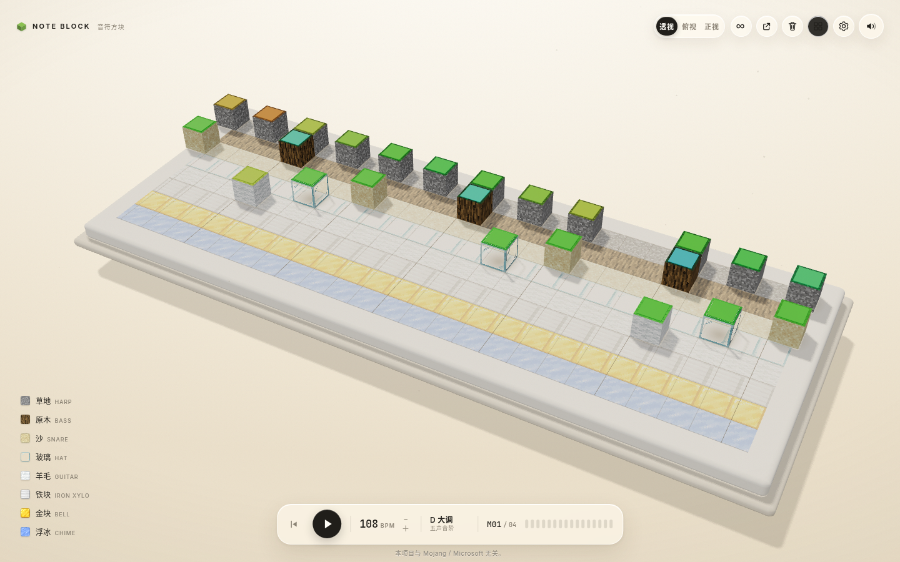

# NOTE BLOCK · 音符方块

> 一台用 Minecraft 的语法写成、用 Apple 的手感演奏的 3D 合成器。

一块默认 16 × 8（拖边缘可放宽到 32 列）的悬浮体素舞台就是钢琴卷：**列是时间，行是地板材质，材质就是音色**。
往舞台里丢方块，世界开始演奏；光柱击中方块的那一帧，整个场景为它让路。


| 俯视 · 读谱 | 无限模式 · 滑动窗口 | 一键清屏 · 波前 + 撤销 |
| --- | --- | --- |
|  |  |  |

| 正视 · 低机位 | 手机竖屏 |
| --- | --- |
|  |  |

| 设置 · 曲长 / 循环 / 音量 | 示例 · 五套编配 | 拖边缘 · 8–32 列 |
| --- | --- | --- |
|  |  |  |

## 运行

```bash
npm install
npm run dev        # http://127.0.0.1:5191
npm run build      # 产物在 dist/
```

需要支持 WebGL 与 Web Audio 的浏览器。作品只保存在当前浏览器，没有账号或服务器。

## 玩法

| 操作 | 结果 |
| --- | --- |
| 在网格空格上点按 / 按住拖动 | 画出音符；一笔只占一次撤销，`Shift` 锁定起始行；画到右缘停留约 120ms 会自动前移 |
| 点按已有方块 | 选中并打开底部音符编辑条 |
| 拖动方块 | 超过 4px（鼠标）/ 8px（触屏）才开始移动；1:1 跟手、速度倾斜，松手按动量投影吸附到格子 |
| 在背景上拖动 | 旋转视角；轻点背景清除选择 |
| 双指拖动 / 张合 | 平移 / 缩放相机，可同时进行；不旋转、不改曲谱 |
| 鼠标中键拖动 | 平移相机（预设视图 `1/2/3` 可复位） |
| 滚轮（悬停方块上） | 每次半音改变音高，顶面色相跟着变 |
| 滚轮（背景上） | 缩放相机；长曲 / 无限模式下 `Shift+滚轮` 或横向滚轮滑动窗口 |
| 右键单击 | 打碎所指方块（9 粒体素粉尘） |
| `Delete` / `Backspace` | 删除选中音符；没有选中时删除悬停方块 |
| 右键拖动 | 连续擦除，一笔一次撤销 |
| 拖到舞台外松手 | 删掉方块 |
| 空格 / 播放键 | 播放 / 暂停；循环关闭时播到末尾停住，再按从头播 |
| 点击左下角材质行 | 静音该行；触屏为折叠的「音色」面板 |
| BPM +/− 或设置里的滑杆 | 60–180；点 BPM 数字可直接键入 |
| `1` `2` `3` / 顶栏「透·俯·正」 | 切换透视 / 俯视 / 正视；`V` 循环 |
| `∞` / `I` | 无限模式：写到哪里曲子长到哪里，没有产品上限，窗口跟着播放头滑 |
| `F` / 适配舞台按钮 | 恢复当前视角的完整构图，不改作品、播放位置或历史 |
| 拖棋盘左右边缘 | 调整可见列数 8–32（按 4 列吸附），不改曲子数据 |
| 设置（`,` 或齿轮） | 曲长 1–32 小节、循环、BPM、主音量、混响，以及数据区的保存状态、重试、分享、恢复、清空；所有数字都能直接键入 |
| 示例（`E` 或顶栏按钮） | 五套现成曲子一键载入，带 mini-map；载入可撤销，载入前自动备份 |
| 顶部垃圾桶 | 一键清屏：红色波前 + 体素尘 + 合成音效，约 5.6 秒内可撤销；清空前自动备份 |
| 拖动底部进度条 / 点步进点 | 进度条常显；拖动时暂停预览，松手后恢复播放；`Home` 回到开头 |
| `⌘Z` / `Ctrl+Z` | 撤销（`⇧⌘Z` / `Ctrl+Y` 重做） |
| 顶部分享按钮 | 把当前作品压进 URL hash 复制到剪贴板；复制失败时把链接放进地址栏供手动复制 |
| 「玩法」按钮 | 三步上手与操作说明；手机上在「更多」里 |

编辑停下约 500ms 后自动存档。分享链接用紧凑二进制编码，一个 60 音的作品约 330 字符。

### 触屏手势

- **单指**：在空格上点按或拖动绘制；轻点已有方块选中；按在方块上移动超过 8 CSS px 才进入拖动，未超过阈值就松手只选中，不产生移动或历史。
- **单指背景**：拖动旋转视角；轻点清除选择。
- **双指**：同向拖动平移，张合缩放；缩放按双指距离相对手势起点的比例计算，慢速捏合也连续生效，并以双指中心为锚，可以边平移边缩放。双指不映射旋转。
- **多指接管**：第二根手指进入舞台时，当前未完成的绘制、擦除或音符拖动会回滚到手势前的快照，不保留误放音符，也不产生新的撤销条目。三指及以上或双指变一指时进入等待，所有手指抬起前不会开始新的绘制、拖动或旋转。
- `pointercancel`、丢失指针捕获、切后台、打开抽屉、旋转屏幕都会结束当前事务，不留下粘住的拖动或额外音符。
- 双指移动的是**相机**，不是时间轴横滑；长曲跳转继续用进度条。

### 移动端布局

- 布局断点只看 CSS viewport 的宽高，不按手机型号：宽度 ≥1024 且高度 ≥600 为桌面；宽大于高且高度 <500 的低高度横屏优先；其余为竖屏 / 窄屏。触摸 / 鼠标提示另按 pointer 能力与最近一次输入区分。
- 手机顶栏收成紧凑一行：视角入口展开「透视 / 俯视 / 正视 / 适配舞台」，示例、无限模式、分享、清空与玩法收进「更多」；设置、静音、播放和撤销 / 重做保持可达。
- 材料行折叠为「音色 · N/8 开启」，展开时不覆盖网格；音符编辑条出现后重新测量舞台可用区域，材料入口与提示相应上移。
- 舞台使用顶栏与底部控制区之间实测出的有效矩形；`ResizeObserver` 与视觉视口变化合并到下一帧统一处理，顶栏、播放栏、材料区和抽屉都适配四边 `safe-area`。
- 横竖屏切换会结束当前手势并重新适配构图；预设视角重新构图，自由视角只约束距离，不抢用户的角度。地址栏伸缩按布局视口处理，软键盘开合只改变视觉视口，不会让舞台和相机重排；自由视角的角度和相对缩放保持不变。
- 竖屏俯视图会自动旋转 90°，让时间轴顺着长边展开。

### 音符编辑条

- 点选方块后，底部编辑条显示「材质 · 音色」、音高与位置读数，并提供「−半音 / +半音 / 试听 / 删除 / 关闭」。
- 音高按采样基准的相对值显示，例如 `音高 15 / 24 · +3 半音`；基准音显示为「基准音」。它不是标准 MIDI 音名，不标 C4 之类的绝对音高。
- 位置按 16 步一小节、4 步一拍计，读数从 1 数起，例如 `第 2 小节 · 第 4 步`；长曲窗口滑动时仍读绝对位置。
- 每次升降一个半音并即时试听；到达 0 / 24 边界时对应按钮禁用，不产生空撤销。对同一音符连续调音约 900ms 内合并为一次撤销。
- 试听走当前主音量与静音状态，不改变曲谱或播放位置；删除走统一删除路径，会同步曲长、选择、历史与保存状态。
- `Esc`、点背景或「关闭」收起编辑条。拖动成功后选择跟随新位置；撤销 / 重做、清空、载入后会校验选择，无法确认同一个音符时清除。
- 桌面悬停另有只读读数（材质、音色、音高、位置）；触屏以编辑条为准。

### 保存状态与数据

设置里的「数据」区始终显示保存状态，主界面只在失败时常驻一条低干扰提示：

| 状态 | 文案 |
| --- | --- |
| 本机已有存档 | 保存在此浏览器 |
| 有改动待写入 | 有修改，等待保存 |
| 写入中 | 正在保存… |
| 成功 | 已保存到此浏览器 · 刚刚 / N 秒前 / N 分钟前 |
| 失败 | 未保存到本机 · 存储空间已满 / 浏览器不允许访问存储 / 写入失败 |

- 失败不会更新最后成功时间，也不会显示「已保存」；状态会保持到真正写成功为止。点击主界面提示或设置里的「重试保存」只写入最新版本。
- 切后台时会先取消未完成的手势再提交最新编辑；`pagehide` 与关闭页面前也会尝试提交，不保存半拖动或半清空状态。
- 清空与载入示例前会写入备份槽，设置里可「恢复上次载入前的作品」；备份失败会明确提示刷新后无法恢复。
- 设置里的「复制分享链接」失败时不会谎称已复制，而是把链接放进地址栏供手动复制；成功复制但链接超长时会提示可能被部分应用截断。

### 帮助、清空与状态提示

- **玩法**：桌面顶栏的「玩法」按钮、手机「更多 → 玩法」打开三步说明（听示例、画音符、选中后编辑）以及快捷键和数据说明。
- **清空**：顶栏垃圾桶、设置「数据」区或手机「更多」均可清空。清空是红色波前动画，反馈会显示清除数量并提供「撤销」；从抽屉触发时反馈留在抽屉内。舞台为空时按钮禁用并标注「舞台已经是空的」。
- **静音**：右上角声音按钮切换全局静音，图标与 `aria-label` 同步变化；点击材质行静音单行，行上出现「静音」标记，折叠标题显示「音色 · N/8 开启」。行静音只影响当前会话，不写入曲谱。
- **空舞台**：没有音符时显示「画下第一个音符，或载入示例」和「浏览示例」按钮。

## 快捷键

| 键 | 作用 | 作用域 |
| --- | --- | --- |
| `Space` | 播放 / 暂停 | 焦点在画布或页面空白（`body` / `html`）时；按钮、输入框、下拉框和文本编辑区保留原生行为 |
| `⌘Z` / `Ctrl+Z` | 撤销 | 非输入框；输入框内先撤销文本 |
| `⇧⌘Z` / `Ctrl+Y` | 重做 | 同上 |
| `1` / `2` / `3` | 透视 / 俯视 / 正视 | 页面快捷键 |
| `V` | 循环切换视角 | 页面快捷键 |
| `I` | 无限模式开关 | 页面快捷键 |
| `E` | 打开示例 | 页面快捷键 |
| `,` / `，` | 打开设置 | 页面快捷键 |
| `F` | 适配舞台 | 页面快捷键 |
| `Home` | 回到开头 | 页面快捷键 |
| `Delete` / `Backspace` | 删除选中的音符；没有选中时删除悬停方块 | 页面快捷键 |
| `Esc` | 取消活动手势 / 拖边缘 → 关闭编辑条 → 关闭最上层抽屉，一次只关一层 | 任意焦点 |

抽屉打开时页面快捷键暂停，只有 `Esc` 生效。点击舞台会把焦点交给画布；Space 不会在按钮上劫持原生激活，也不在文本框、数字输入、下拉框和 `contenteditable` 内触发播放。

## 实现

- **栈**：Vite + TypeScript + three.js，无 React / 无 GSAP。
- **零外部 3D 资产**：8 张 16×16 方块贴图 + 程序化顶面色片 + 程序化接触阴影。
- **动画**：自己写的弹簧（半隐式欧拉、240Hz 子步、`setTarget` 保留速度），
  配合 Apple 的动量投影 `v/1000 · 0.998/(1-0.998)` 做拖动吸附。
- **手势状态机**：`src/gestures.ts` 统一处理单指绘制 / 选中 / 拖动 / 转视角、双指平移与缩放、
  多指接管和等待释放；鼠标阈值 4px、触屏 8px，第二指进入时只回滚当前事务。
- **有效视口**：`src/viewport.ts` 实测顶栏与底部控制区之间的矩形，`ResizeObserver` 与
  `visualViewport` 合并测量；相机适配、投影与拾取共用同一矩形，`three.js` 的 `setViewOffset`
  把舞台居中到可用区域。
- **音符编辑**：`src/note-panel.ts` 负责编辑条 DOM，`src/note-label.ts` 只做相对音高与
  小节 / 步号格式化；选择状态不持久化、不进分享与撤销。
- **保存协调**：`src/persistence.ts` 负责约 500ms 防抖、revision 与可判别结果；
  失败不覆盖最后成功时间，旧写入结果不能覆盖更新的状态。
- **连续绘制**：`pointerdown` 在空格上进入笔触状态机，行跟随指针并带半格滞回，
  `Shift` 锁行；指针跳格时用 Bresenham 补格，单次事件上限 32 格；
  笔触内只记录新增，松手后压一条撤销快照。
- **曲谱 v3**：分享码为 8 字节头 + 4 字节/音符（16 位小节数、24 位音符数），
  解码保留 v1 / v2 分支；本地存档读到旧版本自动迁移。
- **偏好与备份**：音量 / 混响 / 可见列数 / 玩法提示状态存 `note-block:prefs:v1`，不进分享与撤销；
  载入示例或清空前把当前作品写入 `note-block:backup:v1`，可在设置里跨刷新恢复。
- **面板**：`drawer.ts` 一套通用玻璃抽屉（开合、焦点、`Esc`、窄屏遮罩、抽屉内反馈区），
  `config-panel.ts` 与 `example-panel.ts` 只填内容；示例卡片用 canvas 画 mini-map。
- **三视图**：`src/views.ts` 存三组机位参数，用舞台包围盒八角的投影反求相机距离，
  横竖屏自动重新构图；手动 orbit 即进入「自由」状态。俯视图把视差和空闲漂移压到近乎 0。
- **动态窗口**：方块局部坐标只依赖步号（`x = step + 0.5`），窗口偏移单独放在
  `songGroup.position.x = -W/2 - viewStart`；可见列数 `W` 在 8–32 间按 4 列吸附，
  跨档时重建 slab / 地板 / 网格并重新求相机距离，默认 16 列与 v0.2 逐像素一致。
- **无限模式**：可见列数默认 16，拖边缘可放宽到 32；曲长完全由内容决定，不再有 32 小节产品上限
  （工程安全边界 65535 小节 / 1,048,560 步）；窗口外方块隐藏（不产生 draw call），
  音序器按步索引取音符。网格竖线每帧按绝对步边界重画，粗线永远落在 4 的倍数上。
- **进度条**：所有模式常显，带时间读数、小节刻度、悬停提示；拖动时暂停播放做预览，松手恢复。
- **长曲渲染**：每帧只遍历窗口附近约 34 列方块，长曲不会线性拖慢帧率。
- **一键清屏**：14ms/列的红波前扫过，方块逐列碎成体素（`Dust` 池），
  音效是 Web Audio 实时合成的带通扫频 + 低频砸击，不新增音频文件；快照进撤销栈。
- **持久化**：`src/song.ts` 负责曲谱模型、紧凑二进制分享码、`localStorage` 自动存档、
  备份槽和快照式撤销栈；本地曲谱 key 为 `note-block:v1`。
- **音频**：Web Audio，24 个半音的 `playbackRate` 变调；主链路为
  dry + 程序化卷积混响 → 压缩器；音序器以 `AudioContext.currentTime` 为主时钟，
  提前 120ms 调度，视觉从同一队列出队，音画同帧。
- **渲染**：ACES tone mapping、PCFSoft 阴影、RoomEnvironment 环境光、
  InstancedMesh 画所有音高色片与粒子。

## 浏览器与数据存储

- 曲谱、备份与偏好都在 `localStorage`：`note-block:v1`、`note-block:backup:v1`、
  `note-block:prefs:v1`。它们属于**当前浏览器 / 当前站点**，不会跟账号走，也不会自动同步到其他设备。
- 清除站点数据、换浏览器或换设备后，本地作品不会自动出现；需要迁移时用分享链接把作品带过去。
- 隐私模式、存储被禁用或空间不足时写入会失败，界面显示「未保存到本机」并提供重试，不会伪装成已保存。
- 音频需要用户首次操作后解锁；画面依赖 WebGL，音频依赖 Web Audio。

## 资产与版权

- 方块贴图来自 Minecraft（Mojang），取自
  [InventivetalentDev/minecraft-assets](https://github.com/InventivetalentDev/minecraft-assets) 1.20.1，
  仅用于个人非商业演示。
- 音符盒音效来自 [MCSounds](https://o.xbottle.top/mcsounds/)（SomeBottle）的公开资源站。
- 项目源码以 [MIT](LICENSE) 许可发布；`public/tex/` 与 `public/audio/` 下的第三方素材**不在 MIT 覆盖范围内**，
  详见 [NOTICE](NOTICE)。若要公开部署，请替换为自绘贴图与自录/合成音色。
- 本项目与 Mojang / Microsoft 无关，未经其授权、认可或赞助。

## 已知限制

- 移动端双指手势用于相机平移与缩放，不负责时间轴横滑；长曲跳转仍用进度条。
- 有限模式曲长上限 32 小节；无限模式没有产品上限，只受工程安全边界（65535 小节）与浏览器内存约束。
- 分享码 v3 支持长曲；旧版本客户端无法打开 v3 链接，v1/v2 链接仍可读取。
- 预览版没有多轨/多乐器扩展：8 行固定对应 8 种音色（这是「行 = 音色」的概念核心）。
- 音符只有 24 个半音（和游戏内音符盒音域一致），音高读数相对采样基准，不是标准 MIDI 音名。
- 示例曲目为内置编配，暂不支持导入/导出 MIDI。
- 触屏手势与横竖屏布局按 CSS viewport 实现，不按机型写死；不同浏览器 UI、系统手势和软键盘组合仍以真机为准。

## 许可证

代码采用 [MIT License](LICENSE)。第三方素材的归属与限制见 [NOTICE](NOTICE) 和上文「资产与版权」。
