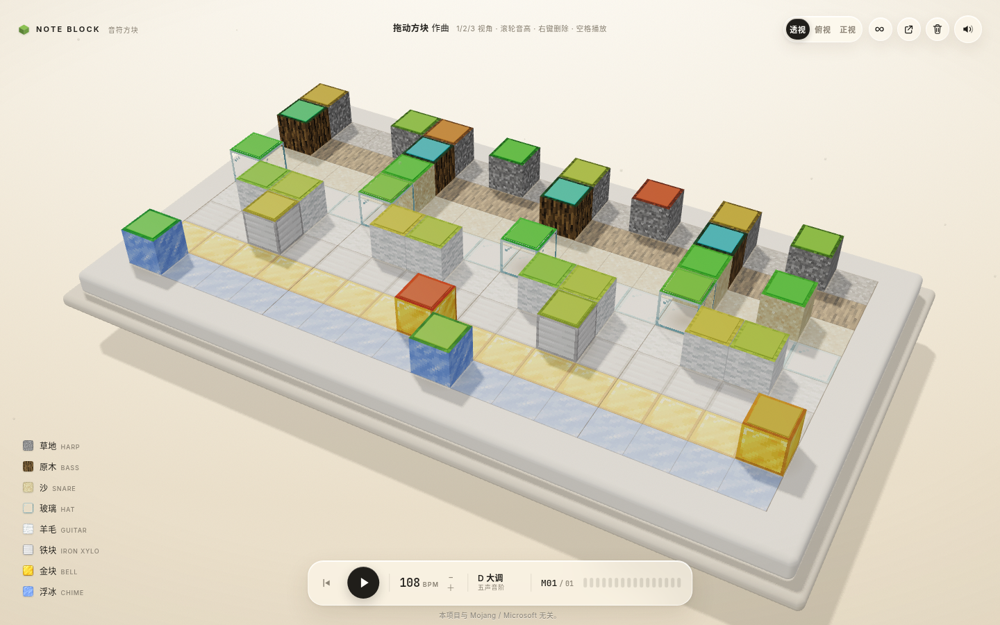
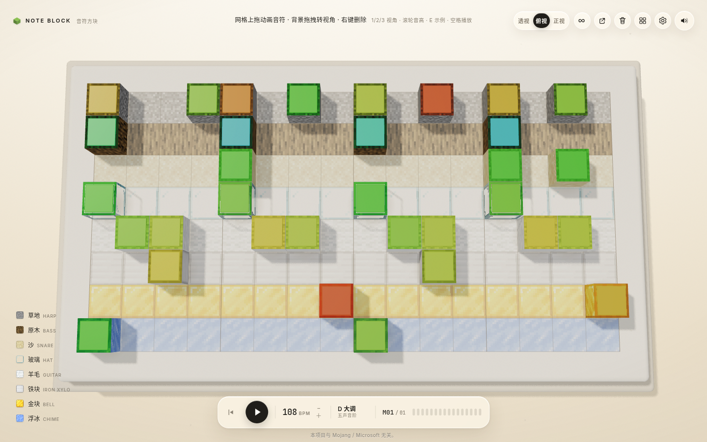
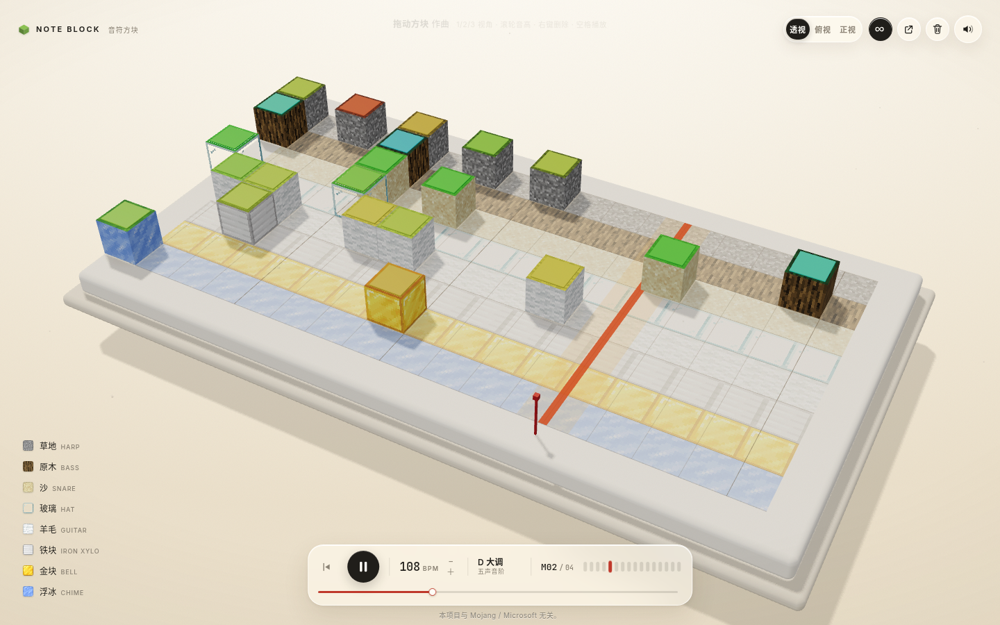
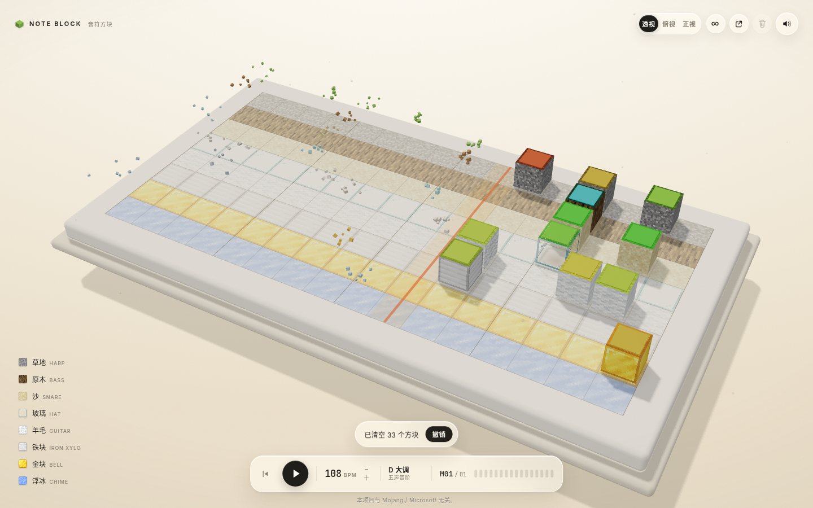
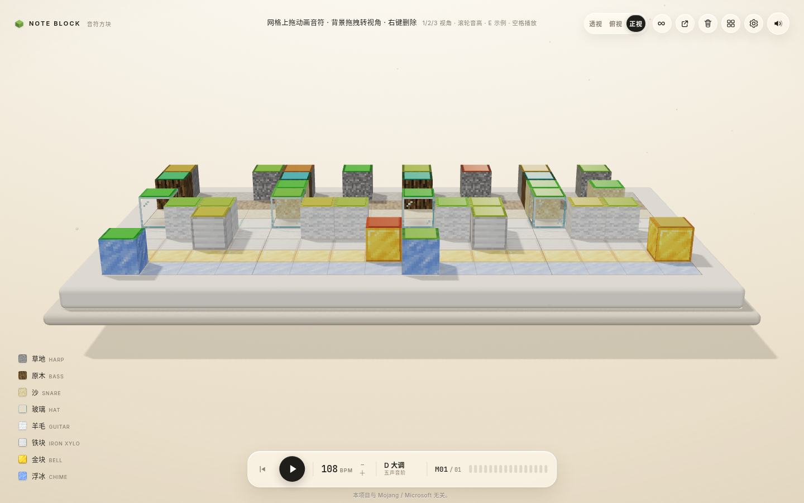
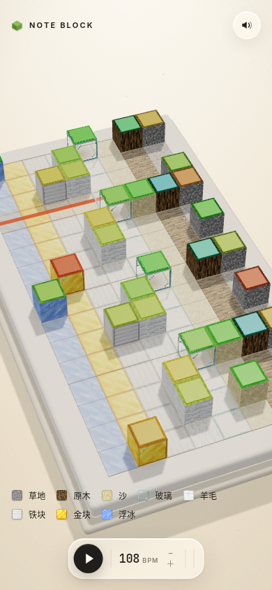

# NOTE BLOCK · 音符方块

> 一台用 Minecraft 的语法写成、用 Apple 的手感演奏的 3D 合成器。

一块默认 16 × 8（拖边缘可放宽到 32 列）的悬浮体素舞台就是钢琴卷：**列是时间，行是地板材质，材质就是音色**。
往舞台里丢方块，世界开始演奏；光柱击中方块的那一帧，整个场景为它让路。



| 俯视 · 读谱 | 无限模式 · 滑动窗口 | 一键清屏 · 波前 + 撤销 |
| --- | --- | --- |
|  |  |  |

| 正视 · 低机位 | 手机竖屏 |
| --- | --- |
|  |  |

## 运行

```bash
npm install
npm run dev        # http://127.0.0.1:5191
npm run build      # 产物在 dist/
```

## 玩法

| 操作 | 结果 |
| --- | --- |
| 在网格空格上按住拖动 | 连续画出音符；一笔只占一次撤销，`Shift` 锁定起始行 |
| 拖动方块 | 1:1 跟手、速度倾斜；松手按动量投影吸附到格子 |
| 在背景上拖动 | 转视角（触屏双指 orbit + 捏合缩放） |
| 滚轮（悬停方块上） | 每次半音改变音高，顶面色相跟着变 |
| 右键单击 / Delete | 打碎方块（9 粒体素粉尘） |
| 右键拖动 | 连续擦除，一笔一次撤销 |
| 拖到舞台外松手 | 删掉方块 |
| 空格 / 播放键 | 播放 / 暂停；循环关闭时播到末尾停住，再按从头播 |
| 点击左下角材质行 | 静音该行 |
| BPM +/− 或设置里的滑杆 | 60–180 |
| `1` `2` `3` / 顶栏「透·俯·正」 | 切换透视 / 俯视 / 正视；`V` 循环 |
| `∞` / `I` | 无限模式：写到哪里曲子长到哪里，窗口跟着播放头滑 |
| 拖棋盘左右边缘 | 调整可见列数 8–32（按 4 列吸附），不改曲子数据 |
| 设置（`,` 或齿轮） | 曲长 1–32 小节、循环、BPM、主音量、混响、分享、恢复、清空 |
| 示例（`E` 或顶栏按钮） | 五套现成曲子一键载入，带 mini-map；载入可撤销，载入前自动备份 |
| 顶部垃圾桶 | 一键清屏：红色波前 + 体素尘 + 合成音效，5 秒内可撤销 |
| 拖动底部进度条 / 点步进点 | 跳到任意位置；`Home` 回到开头 |
| `⌘Z` / `Ctrl+Z` | 撤销（`⇧⌘Z` / `Ctrl+Y` 重做） |
| 顶部分享按钮 | 把当前作品压进 URL hash 复制到剪贴板 |

每 500ms 自动存档到 `localStorage`，下次打开自动恢复；分享链接用紧凑二进制编码，
一个 60 音的作品约 300 字符。

## 快捷键

`1/2/3` 视角 · `V` 循环视角 · `I` 无限模式 · `,` 设置 · `E` 示例 ·
`Space` 播放 · `Home` 回开头 · `Shift` 绘制锁行 ·
`Delete` 删除悬停方块 · `⌘Z/⇧⌘Z` 撤销/重做

## 实现

- **栈**：Vite + TypeScript + three.js，无 React / 无 GSAP。
- **零外部 3D 资产**：8 张 16×16 方块贴图 + 程序化顶面色片 + 程序化接触阴影。
- **动画**：自己写的弹簧（半隐式欧拉、240Hz 子步、`setTarget` 保留速度），
  配合 Apple 的动量投影 `v/1000 · 0.998/(1-0.998)` 做拖动吸附。
- **连续绘制**：`pointerdown` 在空格上进入笔触状态机，行跟随指针并带半格滞回，
  `Shift` 锁行；指针跳格时用 Bresenham 补格，单次事件上限 32 格；
  笔触内只记录新增，松手后压一条撤销快照。
- **曲谱 v2**：`SongState` 增加 `bars`（1–32 小节）与 `loop`；分享码升到 v2
  （6 字节头 + 3 字节/音符），解码保留 v1 分支，本地存档读到 v1 自动迁移。
- **偏好与备份**：音量 / 混响 / 可见列数存 `note-block:prefs:v1`，不进分享与撤销；
  载入示例前把当前作品写入 `note-block:backup:v1`，可在设置里跨刷新恢复。
- **面板**：`drawer.ts` 一套通用玻璃抽屉（开合、焦点、`Esc`、窄屏遮罩），
  `config-panel.ts` 与 `example-panel.ts` 只填内容；示例卡片用 canvas 画 mini-map。
- **三视图**：`src/views.ts` 存三组机位参数，用舞台包围盒八角的投影反求相机距离，
  横竖屏自动重新构图；手动 orbit 即进入「自由」状态。俯视图把视差和空闲漂移压到近乎 0。
- **动态窗口**：方块局部坐标只依赖步号（`x = step + 0.5`），窗口偏移单独放在
  `songGroup.position.x = -W/2 - viewStart`；可见列数 `W` 在 8–32 间按 4 列吸附，
  跨档时重建 slab / 地板 / 网格并重新求相机距离，默认 16 列与 v0.2 逐像素一致。
- **无限模式**：可见列数默认 16，拖边缘可放宽到 32；窗口外方块隐藏（不产生 draw call），
  音序器按步索引取音符。网格竖线每帧按绝对步边界重画，粗线永远落在 4 的倍数上。
- **一键清屏**：14ms/列的红波前扫过，方块逐列碎成体素（`Dust` 池），
  音效是 Web Audio 实时合成的带通扫频 + 低频砸击，不新增音频文件；快照进撤销栈。
- **持久化**：`src/song.ts` 负责曲谱模型、紧凑二进制分享码、`localStorage` 自动存档、
  备份槽和快照式撤销栈。
- **音频**：Web Audio，24 个半音的 `playbackRate` 变调；主链路为
  dry + 程序化卷积混响 → 压缩器；音序器以 `AudioContext.currentTime` 为主时钟，
  提前 120ms 调度，视觉从同一队列出队，音画同帧。
- **渲染**：ACES tone mapping、PCFSoft 阴影、RoomEnvironment 环境光、
  InstancedMesh 画所有音高色片与粒子。

## 资产与版权

- 方块贴图来自 Minecraft（Mojang），取自
  [InventivetalentDev/minecraft-assets](https://github.com/InventivetalentDev/minecraft-assets) 1.20.1，
  仅用于个人非商业演示。
- 音符盒音效来自 [MCSounds](https://o.xbottle.top/mcsounds/)（SomeBottle）的公开资源站。
- 项目源码以 [MIT](LICENSE) 许可发布；`public/tex/` 与 `public/audio/` 下的第三方素材**不在 MIT 覆盖范围内**，
  详见 [NOTICE](NOTICE)。若要公开部署，请替换为自绘贴图与自录/合成音色。
- 本项目与 Mojang / Microsoft 无关，未经其授权、认可或赞助。

## 已知限制

- 手机竖屏俯视图会自动旋转 90° 适配；触屏支持双指 orbit 与捏合缩放，但没有为时间轴做双指横滑。
- 曲长上限 32 小节（512 步），无限模式同样受此限制。
- 预览版没有多轨/多乐器扩展：8 行固定对应 8 种音色（这是「行 = 音色」的概念核心）。
- 音符只有 24 个半音（和游戏内音符盒音域一致）。
- 示例曲目为内置编配，暂不支持导入/导出 MIDI。

## 许可证

代码采用 [MIT License](LICENSE)。第三方素材的归属与限制见 [NOTICE](NOTICE) 和上文「资产与版权」。
